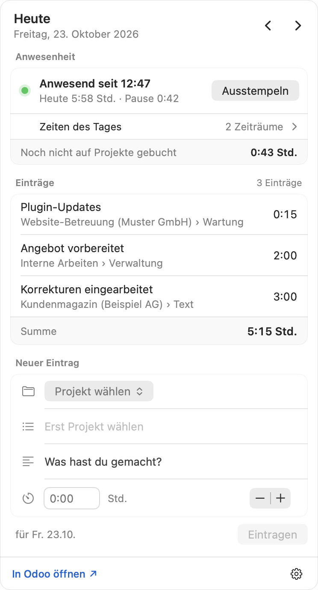
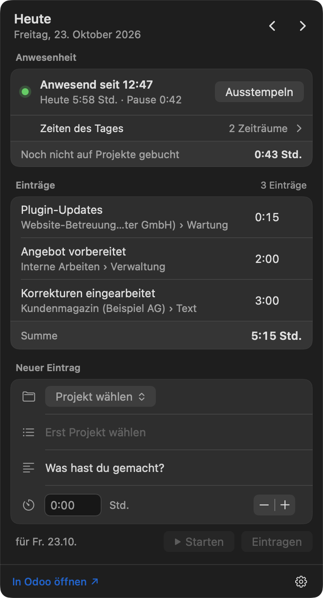
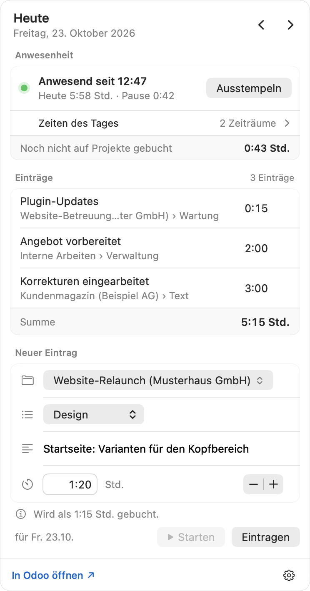
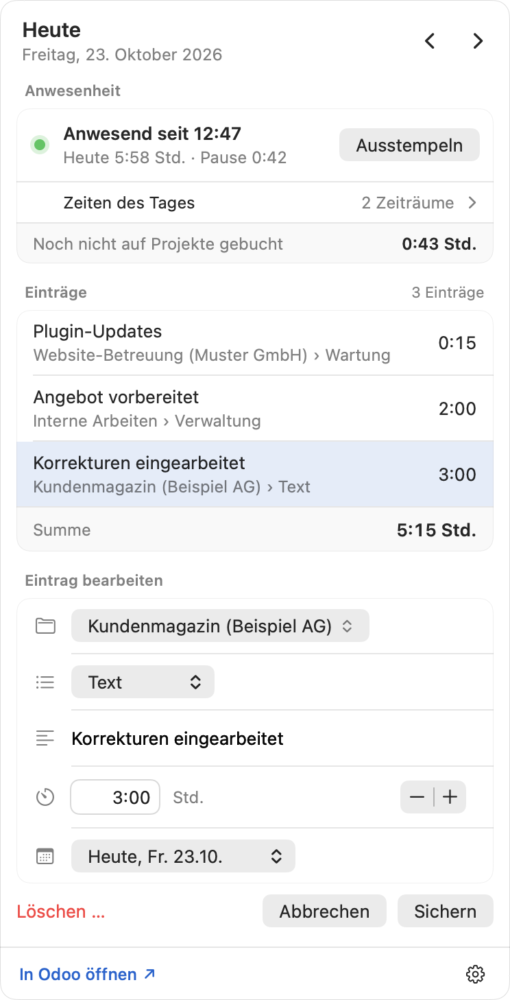
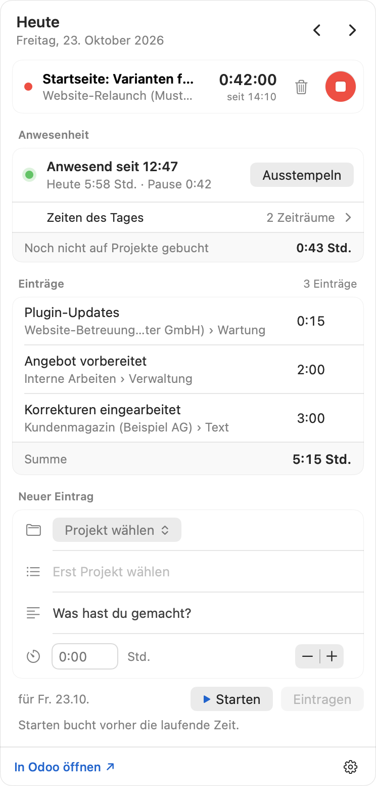
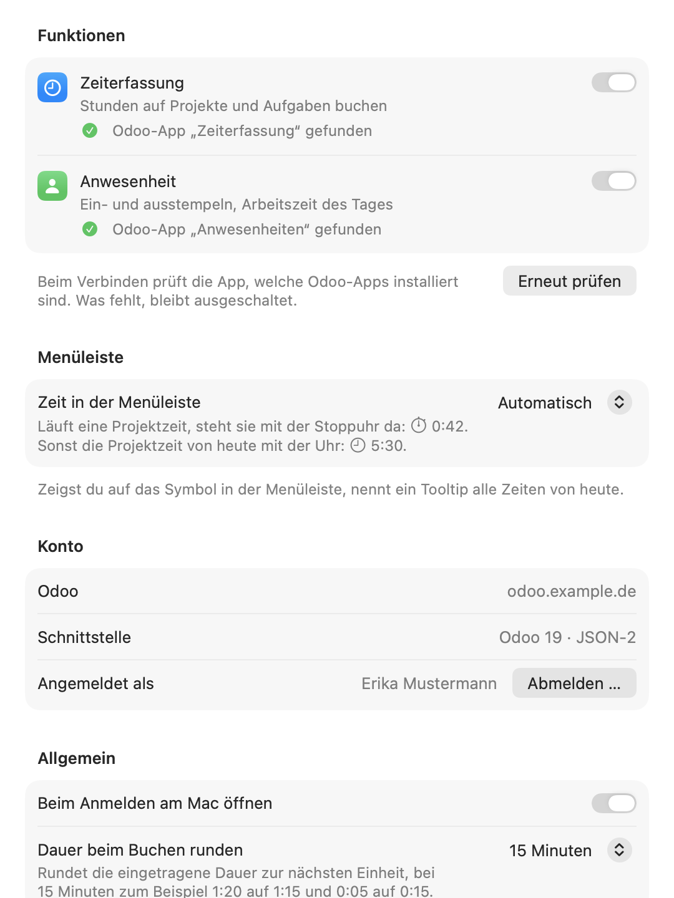
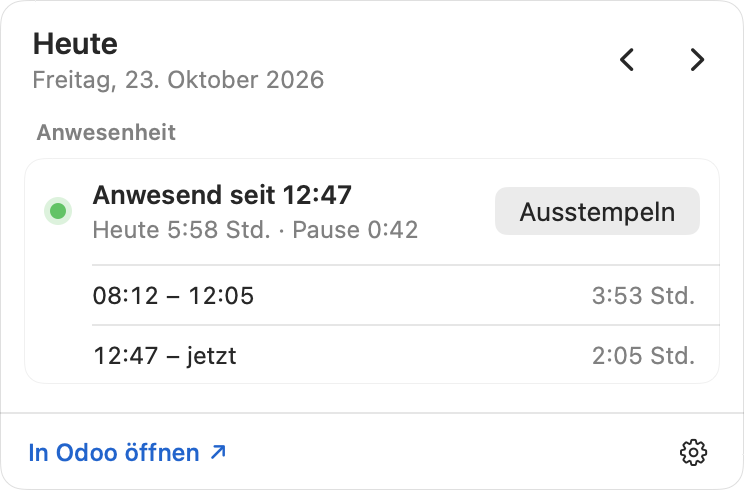

# Zeiterfassung für Odoo

Eigene Stunden und Anwesenheit in Odoo direkt aus der Menüleiste des Mac erfassen: Projekt und
Aufgabe wählen, Dauer eintragen oder die Zeit mit Starten und Stoppen messen. Ein- und
Ausstempeln mit einem Klick; in der Menüleiste steht wahlweise die laufende Projektzeit, die
Projektzeit von heute oder die Anwesenheit.

> **Alpha:** Die App ist neu und wird bei der Baumgärtner Marketing GmbH im Alltag erprobt. Sie
> wird ohne Gewährleistung bereitgestellt (AGPL-3.0, Abschnitte 15 und 16).

<p>
  
  
</p>

## Was die App kann

- **Zeiteinträge:** Projekt (mit Suche, zuletzt verwendete oben), Aufgabe, Beschreibung und
  Dauer. Die Dauer versteht `1:30`, `1,5`, `90 min` oder `1h30`, auch mit englischen und
  französischen Einheiten (`2 hours`, `1 heure 30`), und wird auf Wunsch auf 15, 30 oder 60
  Minuten gerundet. Die Einträge des Tages stehen mit Summe darüber; frühere Tage lassen
  sich durchblättern und nachtragen.
- **Projekt-Timer:** „Starten“ oben im Fenster startet die Zeit sofort; Projekt, Aufgabe und
  Beschreibung wählst du, während sie läuft (Klick auf die Projektzeile), oder beim Stoppen im
  Formular, das dann mit der gemessenen Dauer bucht. Ohne Dauer startet „Starten“ im Formular die
  Zeit für Projekt, Aufgabe und Beschreibung; ▶ an einem Eintrag startet dieselbe Arbeit erneut.
  Es läuft immer nur eine Zeit, ein neuer Start bucht die laufende. Stoppen bucht sofort auf den
  Tag, an dem die Zeit begann, gerundet wie eingestellt; lief sie keine Minute, kommt sie wie eine
  Zeit ohne Projekt ins Formular, verloren geht nichts. Die Zeit läuft weiter, wenn die App
  beendet wird.
- **Bearbeiten:** Ein Klick auf einen Eintrag öffnet ihn unten im Formular, auch um ihn auf einen
  anderen Tag zu legen; löschen geht nach einer Rückfrage. Abgerechnete Einträge sperrt Odoo bis
  auf die Beschreibung, die App zeigt das.
- **Anwesenheit:** ein- und ausstempeln, die Zeiten und Pausen des Tages und wie viel davon noch
  nicht auf Projekte gebucht ist. Mit dem Recht dazu lassen sich Zeiten korrigieren, Pausen
  verschieben, vergessene Zeiten nachtragen und Zeiträume löschen. Hat Odoo automatisch
  ausgestempelt, markiert die App die Zeit zum Korrigieren.
- **Mehrere Firmen:** Die Projektauswahl ordnet die Projekte nach Firma, die Einträge eines Tages
  stehen je Firma mit Zwischensumme. Odoo bucht jeden Eintrag in der Firma seines Projekts; wer in
  mehreren Firmen einen Mitarbeiter hat, wählt in den Einstellungen, für welche Firma er stempelt.
- **Modul „Arbeitszeitgesetz“ (optional):** Ist es in Odoo installiert, erkennt die App die
  Pausen, die Odoo selbst einfügt, und rechnet beim Verschieben einer Pause vor, ob sie reicht.
- **Menüleiste:** neben dem Symbol wahlweise die laufende Projektzeit, die Projektzeit von heute
  oder die Anwesenheit; ab Werk „Automatisch“, also die laufende Projektzeit und sonst die von
  heute. Stoppuhr, Uhr oder Person zeigen, welche Zeit dasteht, der Tooltip am Symbol nennt alle.
- **Funktionen einzeln:** Zeiterfassung und Anwesenheit lassen sich getrennt einschalten. Beim
  Verbinden prüft die App, welche Odoo-Apps installiert sind und welche Rechte der Benutzer hat;
  was fehlt, bleibt mit Begründung ausgeschaltet.
- **Mac-typisch:** hell und dunkel, Tastatur (`↩` trägt ein, `⌘[` und `⌘]` blättern, `⌘T` springt
  zu heute, `⌘R` lädt neu, `⌘,` öffnet die Einstellungen), Beschriftungen für VoiceOver,
  Akzentfarbe des Systems. Startet mit der Anmeldung am Mac.
- **Updates:** Die App sucht einmal am Tag nach einer neuen Version, weist im Fenster darauf hin
  und installiert sie auf Klick.
- **Sprachen:** Deutsch, Englisch und Französisch, nach der Sprache des Mac. Datum und Uhrzeit
  folgen der eingestellten Region, auch mit 12-Stunden-Uhr.

<p>
  
  
</p>
<p>
  
  
</p>

## Voraussetzungen

- macOS 14 Sonoma oder neuer, Apple Silicon oder Intel
- Odoo 17, 18 oder 19, Community oder Enterprise, selbst betrieben, auf Odoo.sh oder Odoo Online.
  Erprobt ist bisher Odoo 19 (Community); den Weg für Odoo 17 und 18 prüfen die Tests gegen
  Odoo 19, das die ältere Schnittstelle noch anbietet, und gegen ein simuliertes Odoo 17.
- die Odoo-Apps *Zeiterfassung* und/oder *Anwesenheiten*; der Odoo-Benutzer muss mit einem
  Mitarbeiter verknüpft sein
- ein API-Schlüssel des eigenen Odoo-Benutzers

## Einrichtung

1. App starten und auf das Uhrsymbol in der Menüleiste klicken.
2. Serveradresse und API-Schlüssel eintragen. Den Schlüssel erstellt man in Odoo über das
   Profilbild oben rechts › *Meine Präferenzen* › *Sicherheit* › *API-Schlüssel hinzufügen*
   (Odoo 17 und 18: *Mein Profil* › *Kontosicherheit* › *Neuer API-Schlüssel*). Er wird im
   Schlüsselbund des Mac gespeichert.
3. Bei Odoo 17 und 18 fragt die App zusätzlich nach dem Benutzernamen, bei mehreren Datenbanken
   auf einem Server nach deren Namen.

Läuft der API-Schlüssel ab, meldet die App das und bittet um einen neuen.

**Ohne Odoo ausprobieren:** als Server `demo` und als API-Schlüssel `demo` eintragen. Die App
zeigt dann erfundene Projekte und Einträge in ihrer Sprache. Was man bucht oder stempelt, bleibt
bis zum Beenden der App erhalten und verlässt den Mac nicht.



## Rechte in Odoo

- **Zeiteinträge:** Das Grundrecht der Zeiterfassung („nur eigene Zeiterfassungen“) genügt, auch
  zum Ändern und Löschen der eigenen Einträge. Abgerechnete Einträge sperrt Odoo bis auf die
  Beschreibung, freigegebene (Odoo Enterprise) ganz.
- **Stempeln und Korrigieren:** Über die Schnittstelle erlaubt Odoo das Anlegen und Ändern von
  Anwesenheiten nur mit dem Recht *Sachbearbeiter: Alle Anwesenheiten verwalten* oder als
  Administrator, außerdem wenn man beim eigenen Mitarbeiter als *Anwesenheitsgenehmiger*
  eingetragen ist. Ohne dieses Recht zeigt die App die Anwesenheit nur an und weist darauf hin;
  gestempelt wird dann weiter in Odoo, Korrekturen trägt die zuständige Person ein.
- Wer nur die Anwesenheiten anderer genehmigt, hat in Odoo das Recht *Sachbearbeiter:
  Anwesenheiten verwalten*, darf aber nicht für sich selbst stempeln. Das zeigt Odoo erst beim
  Versuch; die App blendet das Stempeln dann aus. Nach einer Änderung der Rechte in den
  Einstellungen auf *Erneut prüfen* klicken.



## Wie die App mit Odoo spricht

- **Odoo 19:** die Schnittstelle JSON-2 (`/json/2/<Modell>/<Methode>`) mit dem API-Schlüssel.
- **Odoo 17 und 18** sowie Odoo Online ohne JSON-2: die ältere Schnittstelle JSON-RPC
  (`/jsonrpc`) mit Benutzername und API-Schlüssel. Odoo hat sie mit Version 19 abgekündigt und
  will sie mit Odoo 22 entfernen.
- Alle Aufrufe laufen mit den Rechten des angemeldeten Benutzers. Gelesen werden der eigene
  Benutzer mit seinen Firmen und Mitarbeitern, Projekte, Aufgaben, die eigenen Zeiteinträge und
  Anwesenheiten; geschrieben werden nur die eigenen Zeiteinträge und Anwesenheiten.
- Der API-Schlüssel liegt im Schlüsselbund, die übrigen Einstellungen in den Benutzervorgaben der
  App. Die App verbindet sich nur mit dem eigenen Odoo, sammelt keine Nutzungsdaten und läuft in
  der Sandbox von macOS.
- Unverschlüsselte Adressen (`http://`) sind nur für `localhost` erlaubt.
- Leitet der Server auf eine andere Adresse um, folgt die App nicht, damit der API-Schlüssel nur
  an die eingetragene Adresse geht. Sie nennt stattdessen die Zieladresse.
- Ohne Verbindung versucht die App es selbst erneut, erst nach Sekunden, dann in wachsenden
  Abständen bis fünf Minuten. Bleibt beim Speichern die Antwort aus, prüft sie vor dem nächsten
  Versuch, ob der Eintrag schon in Odoo angekommen ist, und legt ihn nicht doppelt an.

## Installation

1. Unter [Releases](https://github.com/BM1-de/timesheets-for-odoo/releases/latest) das DMG
   laden und öffnen.
2. *Zeiterfassung für Odoo* im Fenster auf *Applications* ziehen, das ist der Ordner *Programme*,
   und von dort starten.

Beim ersten Start aus dem Ordner *Programme* schaltet die App *Beim Anmelden am Mac öffnen* ein;
abschalten lässt sich das in ihren Einstellungen. Die Releases sind mit der Developer ID der
Baumgärtner Marketing GmbH signiert und von Apple geprüft (notarisiert), macOS öffnet sie ohne
Warnung.

### Fassung für den Mac App Store

Für den Mac App Store gibt es eine eigene Fassung (Ziel *Zeiterfassung App Store*), wie Apple es
verlangt: Updates kommen über den App Store statt über Sparkle, und *Beim Anmelden am Mac öffnen*
schaltet man selbst in den Einstellungen ein. Sonst kann sie dasselbe. Texte und Angaben für den
Eintrag stehen in [docs/app-store.md](docs/app-store.md), die Datenschutzerklärung in
[PRIVACY.md](PRIVACY.md).

## Updates

Die App fragt einmal am Tag die Versionsliste
[`appcast.xml`](https://github.com/BM1-de/timesheets-for-odoo/releases/latest/download/appcast.xml)
des neuesten Releases ab. Gibt es eine neue Version, erscheint im Fenster unter der Menüleiste
*Version … ist verfügbar* mit *Installieren …*; die App lädt sie, ersetzt sich und startet neu.
Von Hand: *Nach Updates suchen …* im Kontextmenü des Uhrsymbols oder in den Einstellungen, wo sich
die tägliche Suche auch abschalten lässt.

Dafür nutzt die App [Sparkle](https://sparkle-project.org). Sie installiert nur Versionen, deren
DMG mit dem Schlüssel des Projekts signiert ist und deren App dieselbe Developer ID trägt. Außer
der Abfrage der Versionsliste sendet die Update-Suche keine Daten.

## Selbst bauen

Mit Xcode 16 oder neuer:

```bash
scripts/build-release.sh
```

Das Skript baut die App für Apple Silicon und Intel und legt
`build/release/Zeiterfassung-fuer-Odoo-<Version>.dmg` an; dafür braucht es
[dmgbuild](https://github.com/dmgbuild/dmgbuild) (`python3 -m pip install dmgbuild==1.6.7`). Mit
Developer-ID-Zertifikat und Zugang zur Notarisierung signiert es App und DMG und lässt beide von
Apple prüfen (Hinweise im Skript). Veröffentlicht wird über GitHub Actions, siehe
[RELEASE.md](RELEASE.md).

Die Fassung für den Mac App Store baut, signiert und lädt `scripts/build-appstore.sh` hoch. Es
braucht einen API-Schlüssel von App Store Connect (Hinweise im Skript).

## Entwicklung

- `Zeiterfassung.xcodeproj` in Xcode öffnen; Swift 6, SwiftUI und AppKit. Einzige fremde
  Bibliothek ist Sparkle für Updates (Swift Package, MIT-Lizenz).
- Debug-Builds heißen `de.bm1.ZeiterfassungFuerOdoo.debug` und haben damit eigene Einstellungen,
  eigene Einträge im Schlüsselbund und ein eigenes Anmeldeobjekt; eine installierte App bleibt
  unberührt.
- Tests: `xcodebuild test -project Zeiterfassung.xcodeproj -scheme Zeiterfassung -destination 'platform=macOS'`.
  Sie laufen gegen ein simuliertes Odoo im Arbeitsspeicher.
- Test-Odoo: `dev/start-test-odoo.sh` startet mit Docker ein Odoo 19 mit Demodaten auf
  `http://localhost:8079` und legt API-Schlüssel für vier Benutzer an (in `dev/.env`): einen
  Administrator, eine Mitarbeiterin ohne Sonderrechte, einen Sachbearbeiter, dem Odoo das
  eigene Stempeln verweigert, und eine Benutzerin mit Mitarbeitern in zwei Firmen. Die Tests in
  `LiveOdooTests.swift` laufen dagegen, wenn die Variablen `TEST_RUNNER_ZEITERFASSUNG_LIVE_*`
  gesetzt sind (`…_LIVE_MULTI_KEY` für die zwei Firmen); nie gegen eine Datenbank mit echten
  Daten.
- Zwei App-Ziele teilen sich den Code: *Zeiterfassung* (DMG, mit Sparkle) und *Zeiterfassung App
  Store* (ohne Sparkle, Bedingung `APP_STORE`). Gebaute Apps landen in Ordnern mit der Endung
  `.noindex`, damit Spotlight sie nicht neben der installierten App anzeigt.
- Bildschirmfotos: Ein Debug-Build zeichnet seine Ansichten mit erfundenen Daten in Bilddateien,
  ohne Fenster zu zeigen: `open Zeiterfassung.app --args -renderScreenshots YES`. Die Bilder für
  den App Store (2880 × 1800, mit den Daten des Demo-Modus) zeichnet ein Debug-Build des Ziels
  *Zeiterfassung App Store* mit `-renderAppStoreScreenshots YES -AppleLanguages '(en)' -AppleLocale en_US`.
- Fensterprüfung: `Zeiterfassung.app/Contents/MacOS/Zeiterfassung -panelCheck YES` öffnet das
  Fenster unter der Menüleiste kurz mit erfundenen Daten und prüft, ob es mittig unter dem Symbol
  hängt und so hoch ist wie sein Inhalt.
- Selbsttest gegen das Test-Odoo in der echten App (Sandbox, Schlüsselbund):
  `ZEITERFASSUNG_SELFCHECK_URL=… ZEITERFASSUNG_SELFCHECK_KEY=… Zeiterfassung.app/Contents/MacOS/Zeiterfassung -selfCheck YES`.
- Update-Test: Ein Debug-Build mit `-updateSelfTest YES` lädt ein gefundenes Update still und
  installiert es sofort; mit eigener Bundle-ID, Testschlüssel und lokaler Versionsliste prüft das
  den ganzen Weg bis zum Neustart (Ablauf in [RELEASE.md](RELEASE.md)).
- Übersetzungen: `Zeiterfassung/Localizable.xcstrings`, Ausgangssprache Deutsch, dazu Englisch
  und Französisch. Texte im Code stehen auf Deutsch, in SwiftUI als Text, sonst mit
  `String(localized:)`; Xcode übernimmt neue Texte beim Bauen in den Katalog. Der Test
  „Sprachen“ prüft, ob jeder Text in jeder Sprache vorliegt. Die Tests selbst laufen immer auf
  Deutsch (im Schema eingestellt). Eine andere Sprache ausprobieren:
  `Zeiterfassung.app/Contents/MacOS/Zeiterfassung -AppleLanguages '(fr)'`.
- DMG-Hintergrund: `swift scripts/make-dmg-background.swift`
- App-Symbol: `swift scripts/make-icon.swift`

## Grenzen

- Der Projekt-Timer läuft in der App, nicht in Odoo: Er erscheint nicht im Timer von Odoo
  Enterprise und nicht auf anderen Geräten.
- Sprachen: Deutsch, Englisch, Französisch. Steht keine davon in der Sprachliste des Mac,
  erscheint die App auf Deutsch.
- Ein Odoo-Konto je Benutzer des Mac.

## Marke

Odoo ist eine Marke der Odoo S.A. Dieses Projekt ist unabhängig und steht in keiner Verbindung
zu Odoo S.A. Das App-Symbol ist eigenes Werk und verwendet kein Logo von Odoo.

## Lizenz

Copyright © 2026 Baumgärtner Marketing GmbH. Lizenziert unter der
[GNU Affero General Public License, Version 3 oder neuer](LICENSE).

Die App enthält [Sparkle](https://github.com/sparkle-project/Sparkle) (© Sparkle-Projekt und
Mitwirkende, MIT-Lizenz und weitere freie Lizenzen); der Lizenztext liegt in der App unter
`Contents/Resources/Sparkle-LICENSE.txt` und im Repository unter
`Zeiterfassung/Resources/Sparkle-LICENSE.txt`.

*English: A macOS menu bar app to log your own timesheets and attendance in Odoo 17–19: pick
project and task, enter the duration or time it with start and stop, check in and out with one
click; the menu bar shows the running timer, today's project time or attendance. Uses JSON-2 (Odoo 19) or JSON-RPC (Odoo 17/18) with a personal API key stored in
the Keychain. Signed and notarized DMG releases, updates via Sparkle. User interface in German,
English and French. Alpha, AGPL-3.0, no warranty. Not affiliated with Odoo S.A.*
